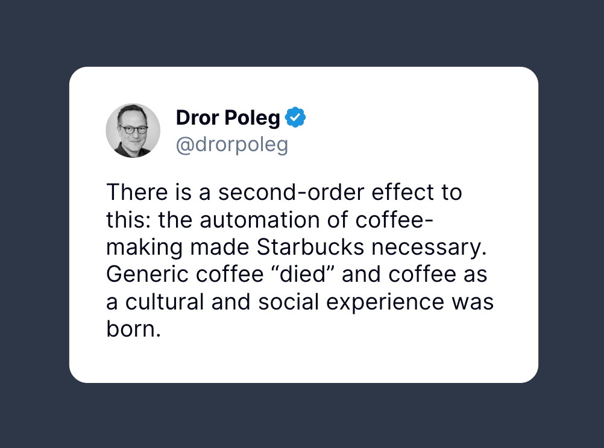

A little story about how automation can improve an industry, and still destroy it.

The coffee industry added mass automation and standardisation for consistency, speed, and scale. The intent was positive, and it worked for a while.

But generic coffee stopped being a category people cared about. If every cup tastes the same, the only differentiator is price. And that’s a race to the bottom.

That vacuum created space for a new industry. Specialty Coffee didn’t win by being faster. It won by adding experience back in:
- craft and technique
- freshness and roasting profiles
- barista skill and hospitality
- flavour as a feature

Automation didn’t kill coffee. It killed undifferentiated coffee.
And it created demand for what automation had ironed out.

Today’s version is happening at scale – services, products and experiences are being optimised into sameness.

Frictionless and uniform benefit the business, not the customer. So it eventually stops benefiting the business. 

People don’t just want the fastest path to an outcome. 
They want signals of care, intention, and truth. They want experience. 

Worth asking in any business:
Are we automating the very friction customers actually want to feel?

Sometimes the biggest opportunities appear right after “efficiency” removes the soul, and the next category is built by bringing it back. 

