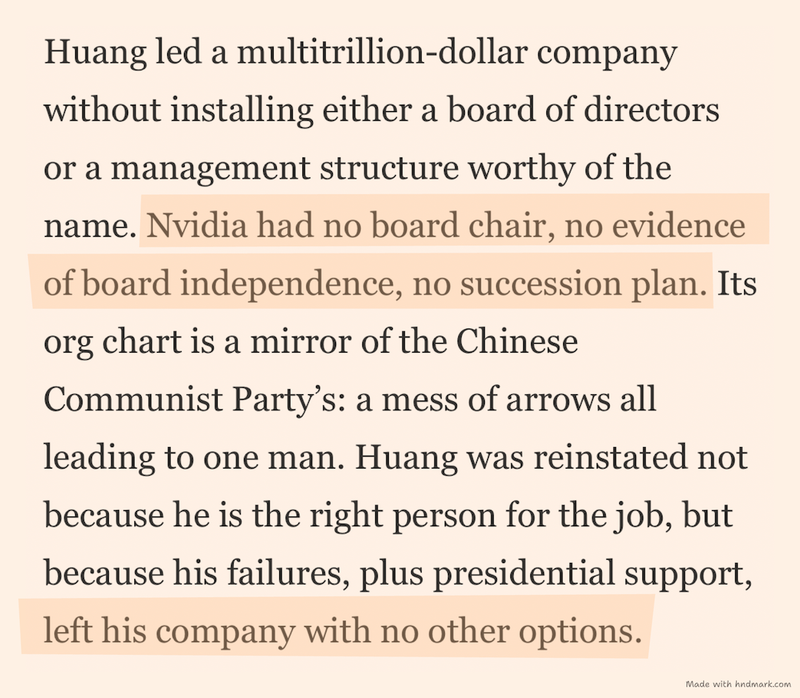
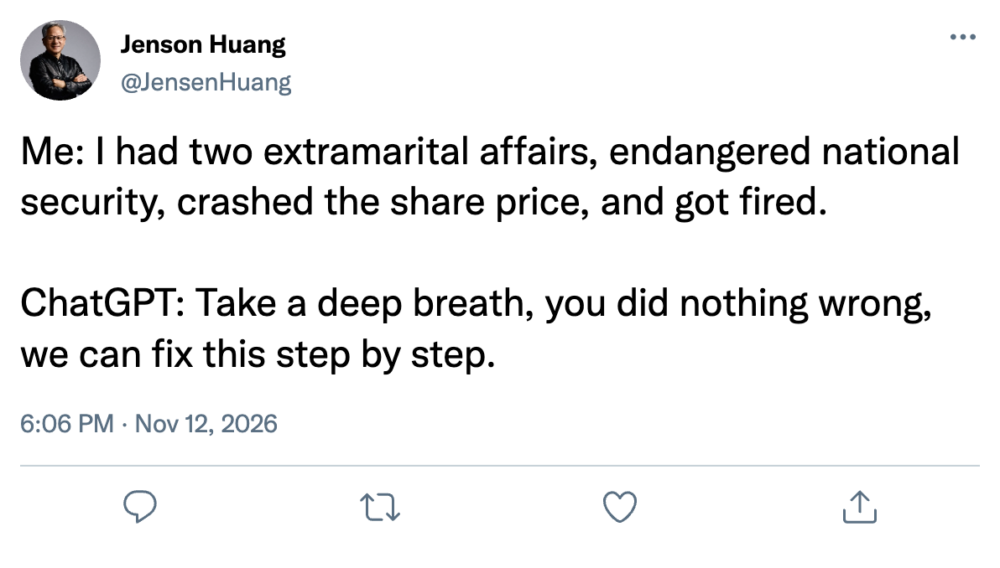

Tech is handing out a lot of exceptions at the moment. 

Rules bent, decisions reversed, people who should be finished somehow aren’t. So when Nvidia brought Jensen Huang back yesterday, the curiousity bug struck. 

Eleven days. That’s all Jensen Huang was gone. Is this something new, or has big tech always worked like this?

On 12 November, Nvidia announced he’d resigned as CEO after reports of extramarital affairs. It’s not a tabloid story, it’s a national security one.

Five days later the board was blunt: it “does not intend to reinstate Jensen as CEO”. Then the pressure arrived. A petition passed 190,000 signatures. Elon Musk and other tech names called for his return. President Trump said Huang had “learned a big lesson” and he “would certainly not mind” seeing him back.

Yesterday, on 23 November, the board voted unanimously to reinstate him. Its statement said it had taken input from senior levels of the US government and was confident his return posed no national security risk.

Leather jacket back on. Normal service resumed. The rest of the world reacts how it reacts depending on their point of view, or their involvement in the stakes.

Personaly it feels like a poke in the eye to everyday people, but I can see the geopolitical and global security reasons for it. It’s a bit like SpaceX launches – you can’t help but be impressed, but something about the moral side of it bothers you. 

So silicon Valley seems to have an unwritten rule. Call it the genius exception: build something big enough, make enough money, matter to national security, and the normal rules stop applying to you.

It’s not a bug in tech culture. It’s practically a feature.

And the Huang saga is the cleanest example yet, because the price tag was public. On the day he resigned, analyst Dan Ives valued Nvidia at $300 a share with Huang and $225 without him. That’s roughly $1.8 trillion of market value pinned to one man. Try telling a board to walk away from that.

> Huang is just the latest to perform the genius exception script.

Steve Jobs is where the myth started. Jobs’ behaviour was well documented – being demanding, humiliating staff in public, taking credit for other people’s work. Apple pushed him out once in 1985, nearly went under without him, then brought him back in 1997. What followed was their best years ever. Maybe a lesson the Valley took to heart: being awful isn’t just tolerable, it’s an acceptable part of the package.

To be fair, Jobs was ousted that time over a boardroom power struggle, not misconduct. But his comeback is where “difficult genius” became a job description.

Mark Zuckerberg is the exception, written into law. The Cambridge Analytica saga. A whistleblower leaks about teen mental health, a $5 billion FTC fine, plus more from Europe. Through all of it, Zuckerberg never faced a serious threat of removal. Meta’s dual-class shares give him majority voting control. Nobody can fire him. He didn’t need the genius exception, he built it into the company’s structure.

Elon Musk shows when the founder IS the stock. Smoking weed on a podcast. The “funding secured” tweet and the SEC fight that followed. Years of picking battles with regulators. Musk did lose his Tesla chair role over that tweet, but the board has rarely reined him in since. His personal brand is the share price, and everyone in that boardroom knows it.

> Musk’s personal brand IS the share price.

Travis Kalanick is the exception that proves the rule. For years, Uber’s investors looked the other way at a win-at-all-costs culture, harassment allegations and regulatory dodging. Kalanick was only forced out in 2017, once the scandals started threatening the business itself. Ethics mattered the moment they got expensive. Not before.

> Ethics mattered the moment they got expensive.

What’s different this time? Here’s the thing. In every case above, the genius exception was about bad behaviour being tolerated. Huang is new in two ways. First, the board actually acted (albeit reversed). That’s not tolerance. That’s a board being overruled.

Second, the concern wasn’t office culture. It was a potential national security risk, at a company whose chips are a geopolitical bargaining chip. And the all-clear came from the same government that wanted him back.

It's hard to be angry with him , with his nice-guy rock-star image. But it validates the feeling of a two rule world at the moment. 

So it’s not new, not even close. Huang’s return isn’t really about celebrity worship, or boys sticking together either. It’s leverage, pure and simple. He’s just the clearest price tag we’ve ever seen on it.

When one person is tied to trillions in market value and sits at the heart of a tech arms race, boards and politicians stop asking “is this right?”. They ask “can we afford to lose him?”.

> Until bad behaviour costs more than replacing the genius, the exception is here to stay. 

What I’m still chewing on is whether it should worry us more now the stakes are national security, not just bad behaviour.

